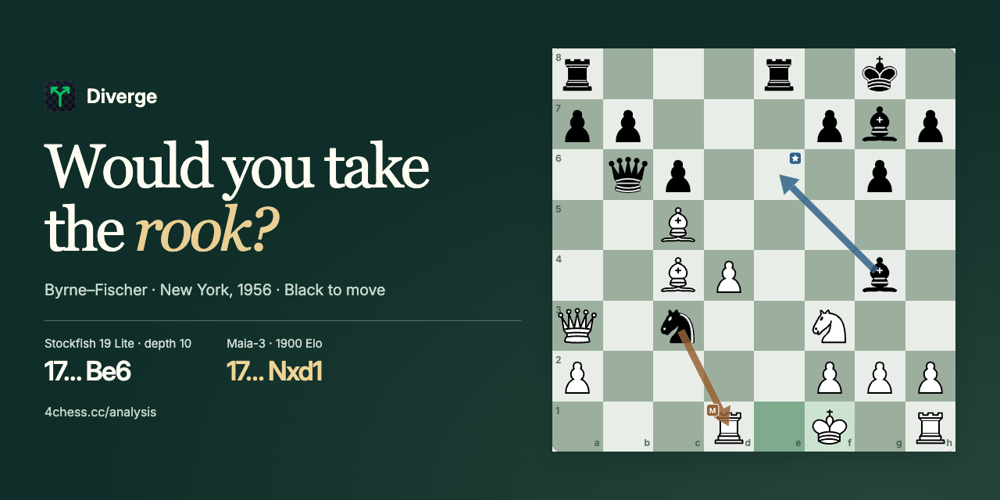
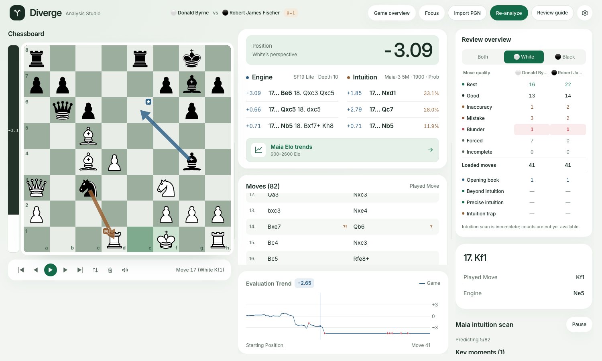
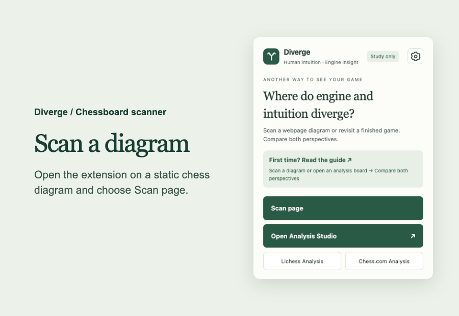
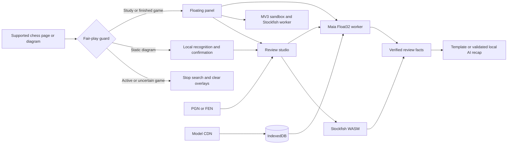

English | [简体中文](https://github.com/keluoke/4chess/blob/main/README.zh-CN.md)

# Diverge

**See where chess engines and human intuition disagree.** Open a finished game or scan a chess diagram. Compare Stockfish’s best move with the move Maia predicts a player at your chosen rating is most likely to play.

[Open the studio](https://4chess.cc/analysis/?lang=en) · [Chrome Web Store](https://chromewebstore.google.com/detail/diverge-chess-analysis-sc/egiimjkekgiaimaagaljiclacljmdkmo) · [User guide](https://4chess.cc/guide/)

   

## Try the position

Open the **Fischer** sample in the studio and select **17. Kf1** in the move list. Black’s knight on c3 can take the rook on d1. At 1900 Elo, Maia-3 5M gives that capture **33.1%**, its highest move probability. Stockfish 19 Lite at depth 10 prefers **17…Be6**, leaving the black queen on b6 under attack. Fischer played the bishop move. Click either candidate to explore what happens next.

For your own game, import a PGN or a supported public game link to review turning points and replay variations. A single FEN opens the position directly. The installable studio can reuse cached assets and model weights offline. First downloads and public game imports need a connection.

## From a diagram to a playable board

Choose **Scan page** on a static chess diagram. Check the pieces, orientation and side to move, correct any recognition errors, then confirm for local Stockfish lines. **Explore engine vs intuition** carries the confirmed position into the studio. Screenshots stay in the browser.

## Engineering highlights

- **Running Maia in JavaScript.** Diverge ports CSSLab’s Maia-3 forward pass to a browser worker, including rating inputs, move history and geometric attention. The loader checks model dimensions and tensor bounds and reuses versioned weights from IndexedDB. A Python harness compares output moves and probabilities with a PyTorch reference. [Inference](engine/maia-inbrowser.js) · [Comparison harness](https://github.com/keluoke/4chess/blob/main/scripts/verify_official_baseline.py)
- **Isolating Stockfish on a host page.** The extension opens a private message port to its engine iframe with a single-use token. The sandbox owns the WASM worker and tracks active searches so stopping an idle engine cannot trigger a search timeout. [Sandbox](engine/stockfish-sandbox.js) · [Concurrent handshake tests](https://github.com/keluoke/4chess/blob/main/scripts/test_sandbox_token_concurrency.mjs)
- **Keeping analysis tied to a permitted source.** The scanner runs a packaged recognition model locally. On ordinary web pages it masks pixels outside eligible image regions. A source-bound scan is rechecked on navigation. During active games the extension stops analysis and clears arrows, candidates and heatmaps. A confirmed finish unlocks review. [Guard](content/fair-play-guard.js) · [DOM lifecycle tests](https://github.com/keluoke/4chess/blob/main/scripts/test_dom_fixtures.mjs)
- **Grounding the local commentary.** Rules extract chess facts first. On supported Chrome installations, an opt-in Prompt API model can phrase a recap using bound placeholders. The validator rejects unknown references and checks for unbound moves, numbers and tactical claims. A deterministic explanation is available when generation fails or the model is unavailable. [Chess facts](engine/chess-facts.js) · [Text validation](analysis/commentary-text.js)

Built and maintained by **keluoke**. Maia-3 comes from CSSLab. Stockfish and its browser port come from the Stockfish and Stockfish.js contributors. Component licenses, modifications and sources are listed in the distribution notices.

[GitHub releases](https://github.com/keluoke/4chess/releases) · [Development](https://github.com/keluoke/4chess/blob/main/docs/DEVELOPMENT.md) · [Engineering write-up (中文)](https://github.com/keluoke/4chess/blob/main/docs/maia-in-the-browser.zh-CN.md) · [License](LICENSE) · [Third-party notices](THIRD_PARTY_NOTICES.md)
