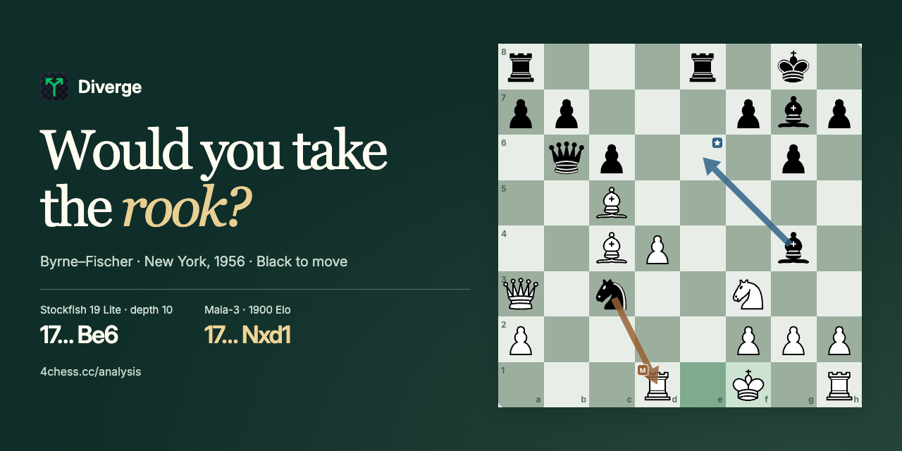
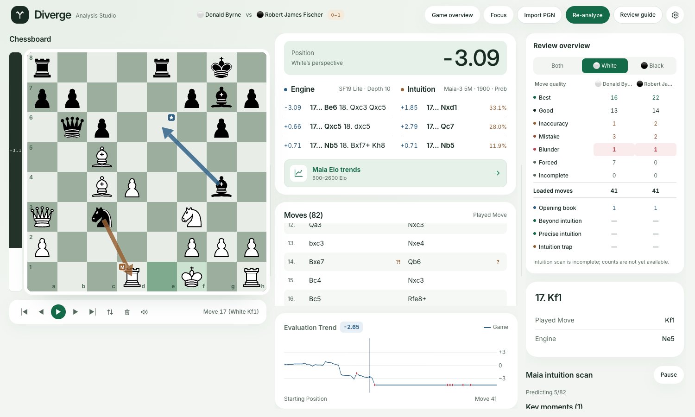
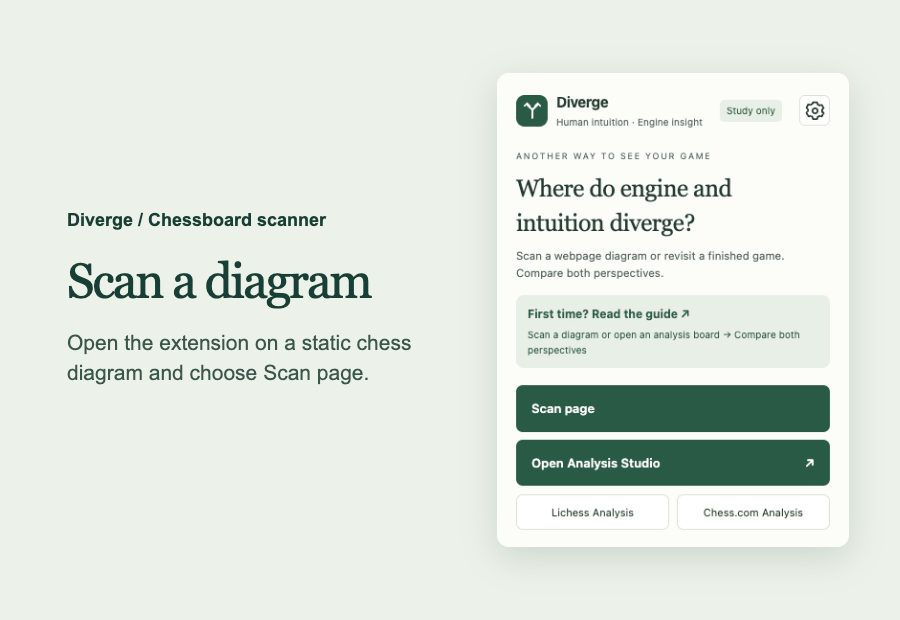
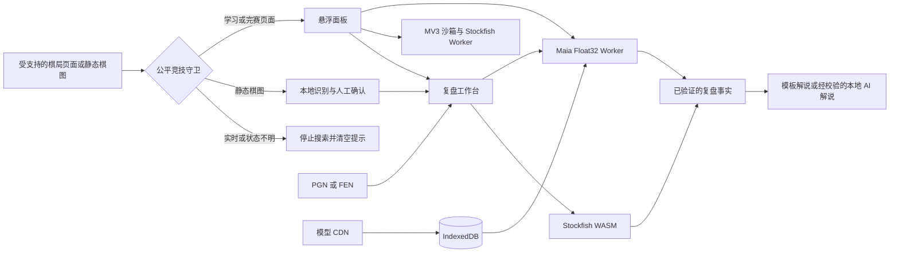

[English](README.md) | 简体中文

# 歧路 Diverge

**同一个局面，引擎想走哪一步，人又最可能走哪一步？** 打开一盘完赛棋局，或扫描一张静态棋图。Diverge 把 Stockfish 的首选和 Maia 对指定等级棋手的走法预测摆在同一块棋盘上。

[打开在线工作台](https://4chess.cc/analysis/?lang=zh) · [Chrome 应用商店](https://chromewebstore.google.com/detail/diverge-chess-analysis-sc/egiimjkekgiaimaagaljiclacljmdkmo) · [使用指南](https://4chess.cc/guide/)

   

## 亲手试这一步

打开工作台里的**菲舍尔示例棋局**，在记谱表点 **17. Kf1**。黑方 c3 的马可以吃掉 d1 的白车。把棋力设为 1900 分，Maia-3 5M 给这步 **17…Nxd1** 的选择概率是 **33.1%**，排在第一。Stockfish 19 Lite 搜到深度 10 时首选 **17…Be6**，让 b6 的黑后继续处在白象的攻击下。菲舍尔实战也选择了走象。点两边的候选着法，就能沿着各自的变化试下去。

你也可以导入自己的 PGN 或受支持的公开对局链接，回看转折点、尝试分支。粘贴 FEN 可直接研究单个局面。工作台支持安装为 PWA，离线时复用已缓存的程序和模型。首次下载权重、导入线上棋谱需要联网。

## 把一张棋图变成可以走的棋盘

在静态棋图上打开扩展，点「扫描网页」，核对棋子、视角和行棋方，需要时可手动修正。确认后，弹窗会给出本地 Stockfish 候选；打开工作台可继续比较 Maia 的选择。截图只在浏览器内处理。

## 工程实现

- **把 Maia 搬进浏览器。** 以 CSSLab 的 Maia-3 为基础，用 JavaScript 实现包含等级分、局面历史和几何注意力的前向计算，在 Worker 内推理。加载器检查模型规格和张量边界，按版本复用 IndexedDB 权重。另有 Python 工具将候选着法和概率与 PyTorch 参考计算对照。[推理代码](engine/maia-inbrowser.js) · [对照工具](scripts/verify_official_baseline.py)
- **让宿主页面与引擎隔离。** 扩展通过一次性令牌与独立 iframe 建立专用消息通道，由沙箱管理 Stockfish WASM Worker。沙箱区分搜索中和空闲状态，避免空闲引擎因没有搜索结果而被误判超时。[沙箱实现](engine/stockfish-sandbox.js) · [多标签页握手测试](scripts/test_sandbox_token_concurrency.mjs)
- **让分析跟随来源状态。** 棋图识别在本地运行，普通网页扫描会遮住允许图像区域以外的像素。来源页面跳转时会重新校验。实时对局停机并清空箭头、候选和热力图，确认终局后自动解锁复盘。[公平竞技守卫](content/fair-play-guard.js) · [DOM 生命周期测试](scripts/test_dom_fixtures.mjs)
- **给本地 AI 解说限定事实。** 先由规则提取棋理，再由用户选用的 Chrome 内置模型组织语言。着法、数值等通过占位符绑定，校验器检查未知引用和未绑定的棋理断言。模型不可用或生成失败时，工作台仍提供确定性解说。[棋理提取](engine/chess-facts.js) · [文本校验](analysis/commentary-text.js)

作者与维护者为 **keluoke**。Maia-3 来自 CSSLab，Stockfish 及其浏览器移植来自 Stockfish 与 Stockfish.js 社区。各组件的来源、修改与许可见分发说明。

[GitHub 发行版](https://github.com/keluoke/4chess/releases) · [开发指南](docs/DEVELOPMENT.md) · [技术复盘：把 Maia-3 搬进浏览器](docs/maia-in-the-browser.zh-CN.md) · [许可证](LICENSE) · [第三方声明](THIRD_PARTY_NOTICES.md)
