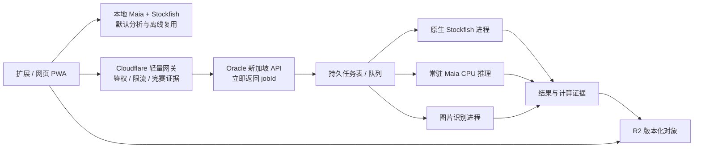

# Diverge 架构评估：Cloudflare 免费资源 + Oracle 新加坡资源

评估日期：2026-10-09（Asia/Shanghai）。代码基线：`c669463`，包含当前工作区尚未提交的 Vision 模块、API、模型资产与构建调整。

结论：现有客户端优先架构适合继续保留。Oracle 最有价值的用途是可选的已完赛整盘分析、公开棋谱预计算与图片识别后台；Cloudflare 继续承担静态页面、模型 CDN、轻量网关和结果分发。Oracle 实例配置待确认，因此下面是条件性设计，不是部署或性能承诺。

## 1. 当前架构与职责

| 层次 | 当前实现 | 判断 |
|---|---|---|
| 产品入口 | Chrome MV3 扩展、独立网页/PWA | 同一分析内核服务两个入口，值得保留 |
| 平台适配 | `content/` DOM 棋盘检测、MAIN world bridge、`background.js` 请求代理 | 宿主兼容代码应隔离于计算核心 |
| 计算 | Maia Float32 JS，能够使用 Worker；Stockfish 19 Lite single WASM + Worker/iframe | 单局面可用、无需推理服务器；整盘耗时受用户设备影响 |
| 复盘 | GameAnalyzer：局面链 → Stockfish 逐局面 → Maia 逐着法 → 候选加深复核 | 顺序阶段造成长任务，适合引入调度与可选后台 |
| 缓存 | 模型 IndexedDB；预测 Map；整盘结果 Map + chrome.storage/localStorage；PWA CacheStorage | 已有基础，但版本、容量和计算证据需要加强 |
| 云端 | Pages 静态分发；`/api/chesscom` 获取对局；新增 `/api/vision` | 已有轻量代理，尚无生产级后台分析任务系统 |
| 公平竞技 | FairPlayGuard + 控制器 epoch + 停止搜索/清除视觉 | 必须沿用，并扩展到远程任务生命周期 |

Maia 默认模型 URL 是 `https://weights.4chess.cc/maia3_model.bin`，实际响应声明为 29,326,424 字节，约 27.97 MiB。Stockfish 本地 WASM 约 1.7 MiB；新增识别权重 620,852 字节、WASM 6,349 字节。大 Maia 权重保持外部分发，不入 Git、不进扩展包、不进入 Pages 静态产物。

代码依据：[Maia 协调器](/Volumes/AI/coding/simoextension/engine/maia-engine.js:16)、[复盘流程](/Volumes/AI/coding/simoextension/engine/game-analyzer.js:769)、[Stockfish 适配器](/Volumes/AI/coding/simoextension/engine/stockfish-inbrowser.js:474)、[识别核心](/Volumes/AI/coding/simoextension/lib/vision/recognizer-core.js:39)。

## 2. 当前证据与验证边界

### 本次完成

- `npm test` 通过：包括 24 个公平竞技场景、DOM 生命周期、代理校验、缓存身份、沙箱握手、声音和 Vision 模块导入等。
- `node scripts/test_game_analyzer.mjs` 通过。该脚本使用模拟 Stockfish/Maia，证明复盘编排与缓存等逻辑，不证明真实双引擎强度、吞吐或分类正确率。
- 普通线上 URL：`https://4chess.cc/analysis/` 返回 HTML 200；`/engine/maia-engine.js` 返回 JS 200，与本地文件逐字节一致。
- 普通线上 `https://4chess.cc/api/vision` 返回 HTML 200，未得到本地路由声明的 JSON capabilities；不能认定识别 API 已在线可用。
- 默认权重 URL 的 HEAD 请求为 200，Content-Length 为 29,326,424。仅据此确认资源存在及声明大小，不把 HEAD 当成模型完整性或推理精度证明。

### 本地计算计时

环境：Apple M4、arm64、Node v24.6.0。未更改模型或业务代码。Maia 权重由 CDN 读取到内存，未落盘或入库。

| 任务 | 本次结果 | 限制 |
|---|---|---|
| Maia 模型解析 | 35.12ms | 不含网络下载、IndexedDB 读取和浏览器 Worker 启动 |
| Maia JS 单局面 | 三个合法局面：403.04 / 398.27 / 260.16ms wall time | 小样本、无真实历史输入，不是手机或 Oracle 压测 |
| CNN WASM 初始化 | 20.86ms wall / 22.75ms CPU | 从本地文件读资源 |
| CNN WASM 64 格推理 | 三次：178.88–193.86ms wall / 177.19–190.71ms CPU | 合成灰度棋格，仅衡量计算开销，不衡量识别正确率 |

这些数据支持“计算负载显著大于轻量请求”的判断；不能换算成 Oracle 的确定加速倍数。尤其较强桌面设备本地单局面分析可能比共享云端更快。

未连接 Oracle 控制台/SSH，未确认实例、租户额度、CPU 型号、网络质量，也未做浏览器、手机、真实宿主对局的本轮验收。

## 3. 免费资源的现实边界

Cloudflare Workers Free 当前列出每日 100,000 请求、每次 HTTP 请求 10ms CPU、每 isolate 128MB 内存；Pages Functions 使用 Workers 配额。网络等待不计入 CPU，CNN/矩阵运算和像素循环计入。因此网关等待 Oracle 返回可以成立，直接把当前完整识别或双引擎计算塞进免费 Function 不能作为稳定方案。本地计时提示高风险，最终应以 Cloudflare invocation CPU 指标验证。[Workers 限制](https://developers.cloudflare.com/workers/platform/limits/)、[Pages Functions 计费](https://developers.cloudflare.com/pages/functions/pricing/)。

Pages 单个静态资产最大 25 MiB。R2 Standard 免费额度为每月 10 GB-month、100 万 Class A、1000 万 Class B 操作，互联网出站免费；超出免费存储/操作额度仍计费。模型 CDN 继续利用对象存储与缓存，没必要迁移至 Oracle 单机。[Pages 限制](https://developers.cloudflare.com/pages/platform/limits/)、[R2 定价](https://developers.cloudflare.com/r2/pricing/)。

Oracle 当前 Always Free 文档列出 A1 每月 1,500 OCPU-hours、9,000 GB-hours，对 Always Free tenancy 相当于 2 OCPU / 12GB；AMD Micro 每台为 1/8 OCPU、1GB，最多两台。免费计算需在 home region 创建；存在容量不足与空闲实例回收条件。历史教程常见的 4 OCPU / 24GB 不能作为本账户当前免费额度的保证，应查看 Limits, Quotas and Usage 及实际计费权益。[Oracle Always Free 官方说明](https://docs.oracle.com/en-us/iaas/Content/FreeTier/freetier_topic-Always_Free_Resources.htm)。

| 实际拥有的实例 | 建议 |
|---|---|
| A1 ARM，约 2 OCPU / 12GB | 优先验证单个整盘后台任务、原生 Stockfish、小模型常驻推理 |
| A1 ARM，4 OCPU / 24GB，且账户确认额度覆盖 | 可试 1–2 个整盘任务；仍以总 CPU、队列时间和免费权益约束为准 |
| AMD Micro，1/8 OCPU / 1GB | 轻量 API、任务元数据、监控；不建议承担主要双引擎计算 |
| 尚未取得可运行实例 | 维持客户端主路径，先制定基准；不要把产品可用性绑定抢占实例 |

## 4. Oracle 的用途排序

### A. 已完赛整盘复盘：优先级最高

一次提交、异步处理，返回逐步进度和结果。手机减少持续 CPU、发热和前台驻留；用户可以重新打开页面继续查看。云端使用原生 Stockfish 和常驻 Maia 推理进程，不要求每个用户重复下载模型。

这最后一项仅在“完整云分析模式”中成立：现有工作台会初始化本地引擎，必须改为按所选执行方式懒加载，才能真的避免本地权重下载。只把 Stockfish 放到云端、Maia 保持本地时，Maia 下载和计算仍然存在。

先内部处理少量公开已完赛棋谱，再开放受限用户任务。任务量增加时排队，超过预算时回退本地或稍后处理。免费服务器适合小规模增强，不承担无限并发承诺。

### B. 公开棋谱预计算 + 结果复用：收益确定性较高

Oracle 计算公开归档的代表性棋谱、训练题和关键局面，版本化 JSON 存入 R2。前端命中结果时直接读取，避免多用户重复算同一棋谱，也不需要上传用户私人棋谱。

优先计算有真实使用需求的内容；在引擎版本、规则或 Maia 参数变化时重新计算。不要预计算无限 Elo 档位或无用局面。

### C. 图片识别后台：适合承接现有边缘 API 负载

本地识别继续是默认选项。用户明确选择远程处理时，上传裁剪后的 PNG/JPEG/WebP，由 Oracle 解码、识别并返回原始置信度、候选及待确认项。

当前 `/api/vision` 使用 base64 RGBA：1024×1024 图像的 base64 已约 5.33 MiB，逼近 6 MiB 请求限制；2048×2048 约 21.33 MiB，会先被请求体上限拒绝。数字数组 JSON 更大。将压缩图片直接上传可减少传输，但必须限制解码尺寸/像素数、并发与内存。

当前每次请求都创建 recognizer 并初始化模型。Oracle 可保留预热进程和受控并发，先优化任务/协议再考虑更大识别模型。

当前 review 路由重新使用同一套识别核心与权重再合并客户端结果，并不自然形成独立第二模型。同模型换服务器执行通常不提高识别准确率；不同模型、预处理或独立证据需要标注数据集验收。FEN 合法性也不等于图像识别正确。

依据：[请求边界](/Volumes/AI/coding/simoextension/functions/api/vision.js:29)、[逐请求初始化与结果合并](/Volumes/AI/coding/simoextension/functions/api/vision.js:429)。

### D. 工程后台：较低成本的补充

运行定时基准、权重导出/校验、公开棋谱清洗、纠错样本统计、版本回归和服务监控。可以把公开预计算结果作为跨浏览器/未来小程序的共同数据层。

这些用途不要求先建立账户系统。短期使用 SQLite + 本地持久任务表即可；不必为单节点引入 Kubernetes、Redis 或多套数据库。

### E. 暂不优先

- 迁移静态网站或主模型 CDN：增加单点故障和运维，当前没有证明它能改善访问速度。
- 每次棋盘点击都请求新加坡单局面计算：网络往返和队列可能抵消算力收益。
- 大模型训练、无限公共推理、把 A1 当 GPU 资源：与已确认的免费 CPU 资源和产品规模不匹配。

新加坡地域本身不证明中国大陆/目标用户网络更快。需分别测前端到 Cloudflare、Cloudflare 到 Oracle、完整业务路径的延迟和上传耗时。

## 5. 建议目标架构

这是拟议架构，图中的 Oracle 分析服务目前不存在。私人任务结果需受访问控制，不能因使用 R2 就公开。

Cloudflare Tunnel 可让 Oracle 通过出站连接接入 Cloudflare，减少公开源站端口；它不增加 CPU 或消除跨境延迟。应用鉴权、限流和任务所有权仍须单独实现。[Tunnel 官方说明](https://developers.cloudflare.com/cloudflare-one/networks/connectors/cloudflare-tunnel/)。

单节点起步：一个 API 进程、一个整盘任务 worker、SQLite/WAL 任务表、有限原生引擎进程、R2 结果/备份。Maia 与 Stockfish 的线程预算共同受 CPU 核数约束。A1 2 核从一个整盘任务、Stockfish 1 thread、Maia 1 thread 的方案测起，避免每个库默认占满所有核。

Stockfish 官方编译体系支持 ARM 目标；Maia 官方把 5M 列为 CPU 入门模型。两者说明技术路线可行，不证明当前 JavaScript 导出与新服务端运行时天然等价。先固定模型 revision、输入历史、Elo 与输出概率语义，再做两端对照。[Stockfish 编译文档](https://official-stockfish.github.io/docs/stockfish-wiki/Compiling-from-source.html)、[Maia 官方仓库](https://github.com/CSSLab/maia3)。

## 6. 接入后台前的架构欠账

1. **抽出纯复盘核心。** GameAnalyzer 1516 行，同时负责 DOM/API 提取、PGN/TCN、缓存、计算、标签和宿主跳转；analysis.js 2109 行混合会话/UI/调度。把 import adapters、ReviewCore、ResultStore、UI 拆成边界清楚的模块，复用而非重写。
2. **统一调度与超时。** Stockfish 同时被全盘分析和局面预览调用；当前只有一个 active 和一个 queued 请求。明确预览/整盘优先级、取消和总预算。`evaluate()` 超时首先移除等待项，不等于搜索进程必然结束；整盘调用者会补 stop，其他调用链仍应核查。[引擎请求](/Volumes/AI/coding/simoextension/engine/stockfish-inbrowser.js:474)。
3. **Worker 故障结算。** Maia `worker.onerror` 会把 worker 设为 null，却没有在这里统一 reject 加载等待及 pending 推理，可能留下悬挂任务。为加载/推理设 deadline，错误时清理、重建，避免无界等待。[Worker 生命周期](/Volumes/AI/coding/simoextension/engine/maia-engine.js:83)。
4. **拆分 Stockfish / Maia 缓存。** 现整盘 key 将 depth 和 Elo 绑定，改 Elo 会造成 Stockfish 重算。SF 缓存使用局面链、精确构建/网络、预算；Maia 使用权重 hash、编码版本、完整相关历史、双方 Elo；标签按规则版本重算。远程原生 Stockfish 与本地 Lite 不应因名称相同共享同一结果 key。[整盘 key](/Volumes/AI/coding/simoextension/engine/game-analyzer.js:594)。
5. **模型内容版本。** Maia 缓存以 URL 派生身份为主，固定 URL 换权重可能仍读旧缓存；下载完成后目前在解析前发起持久保存。增加可信 manifest、内容 hash、大小校验，验证成功再缓存，失败驱逐。IndexedDB 读取、解析和启动都有时间，不能把“缓存免下载”写成字面 0ms。[模型加载](/Volumes/AI/coding/simoextension/engine/maia-inbrowser.js:39)。
6. **结果证据。** 云算力不会自动修复标签判定。保存 actual depth、nodes、预算、score bounds、mate/draw、实战与 Maia 指定走法的验证状态；缺失/超时/不足深度保持未知或待复核。当前加深流程存在从浅层 loss 回退、以零损耗视作深搜最佳等路径，应在统一规则时单独验收。[加深复核](/Volumes/AI/coding/simoextension/engine/game-analyzer.js:1140)。
7. **PWA 升级与 API 缓存。** 预缓存表缺少 `maia-worker.js`、`opening-book.js`、守卫与新增 Vision 等依赖；此前在线使用过可能动态缓存，但首次离线不完整。SW 对非 JS/HTML 的同源 GET 默认 cache-first，未来 job/status API 必须显式 bypass，避免读到旧进度；JS 与未带 hash 的长期缓存 WASM 也应作为同一版本交付。[SW](/Volumes/AI/coding/simoextension/analysis/sw.js:9)。
8. **构建与资产防线。** 新构建脚本缺资产时尝试从邻接 `../chesspuzzle` 恢复，不保证干净 CI 可复现；新模型当前未跟踪。应明确白名单产物、缺失即失败、hash 验证。现 `npm run package` 将整个 models 目录纳入 ZIP，`.gitignore` 不会阻止 ZIP 带上本地 Maia 大文件，应显式排除并检查体积。[构建](/Volumes/AI/coding/simoextension/scripts/prepare_cloudflare.mjs:20)、[打包](/Volumes/AI/coding/simoextension/package.json:9)。
9. **静态/动态路由。** 确认最终 `_routes.json` 只让所需 API 调用 Functions，Pages CI/Wrangler 可能自动生成；不能仅凭源码没有该文件断言线上所有静态访问都消耗 Workers。[官方路由说明](https://developers.cloudflare.com/pages/functions/routing/)。
10. **真实产品状态。** 当前没有发现 analysis/content 主入口接入 Vision；现阶段是基础模块与 API 草案。建立 JSON capabilities/版本核验，分别报告源码、测试、生产接口和手机可用性，避免把 HTML 200 当接口上线。

## 7. 公平竞技、隐私与可用性

远程入口初期仅支持服务器能独立取得明确终局证据的公开已完赛对局和维护的题库。客户端 `finished: true`、PGN `Result` 或用户传入的 FEN 都不能独立证明外部比赛结束；不开放无约束实时着法建议 API。

沿用 FairPlayGuard，任务绑定 sourceGameId、gameEpoch、jobId 与完赛快照。新局上锁时取消用户关联任务/结果展示，清空箭头、热力图和候选，远程晚到响应不得重新解锁。网络取消有传播延迟，不能承诺服务器也在 150ms 内停机；本地展示必须独立立即锁定。

目前守卫 MutationObserver 使用 150ms 定时节流，仅是调度设置，无法证明繁忙主线程下的 150ms 最坏时延。Maia 全盘调用没有传入取消检查，取消后可能等待当前推理完成。迁移时需验证真正停止计算与不展示结果两个不同要求。[观察器](/Volumes/AI/coding/simoextension/content/fair-play-guard.js:253)、[Maia 全盘循环](/Volumes/AI/coding/simoextension/engine/game-analyzer.js:1059)。

本地分析保持默认；远程上传由用户明确选择。远程模式更新当前“棋谱绝不上传”的隐私说明，规定保留期、删除和私人结果权限；纠错样本另行选择，不能默认收集截图。新增 Vision 来自其他项目的规则库/权重/代码也需完善来源与许可记录。网络提供改动的 Maia 派生服务时，应核对对应 AGPL 源码提供义务与模型许可，不能用服务化规避许可边界。

Oracle 被回收、宕机、更新或队列满时，页面仍由 Cloudflare 提供，提示后台不可用并让用户选择本地分析。任务表、结果和必要配置应有异地备份；免费单机不应成为唯一副本。

## 8. 分阶段实施与容量验证

**第一阶段：内部基准。** 确认 Oracle 实例/租户权益；选取 20–50 盘明确完赛棋谱，覆盖长短局、将杀、残局、自定义起始 FEN；在本地与 Oracle 测相同输入。记录加载耗时、Maia p50/p95、SF nodes/s 与达到预算的实际深度、整盘 wall/CPU 时间、RSS 和失败率。

**第二阶段：公开棋谱预计算。** 单 worker、模型常驻、任务持久化、R2 版本化结果。验证重复提交去重、服务重启恢复与结果语义。按证据固定本地/云端共用 schema。

**第三阶段：可选云复盘。** API 提交立即返回 202/jobId；查询进度、获取结果、取消任务。接口可采用 `POST /api/review/jobs`、`GET /api/review/jobs/:id`、`DELETE /api/review/jobs/:id`，具体名称在实施时确定。先限定公开已完赛来源，再评估私人输入的合法使用证明与隐私流程。

**第四阶段：识别后台与产品适配。** 压缩图上传、解码边界、分类器预热、标注集准确率、手动修正和纠错样本。相同后台可以服务网页与未来小程序，但还需各端实际接入和验收。

容量按实测估算：`每小时任务数 ≈ 核数 × 3600 × 目标利用率 ÷ 每盘合计 CPU 秒`。例如“2 核、50% 分析 CPU 预算、每盘消耗 60 CPU 秒”得到约 60 盘/小时，仅为算式示例；未压测前不能当产品承诺。需加入长尾、网络、排队、进程重建和共享主机波动，且长期入队速率应小于出队速率。

发布验收覆盖真实手机前台/后台、断网、取消、新局锁定、晚到结果、服务重启、Oracle 不可用、超额拒绝、模型升级和普通生产 URL 的 JSON/MIME/版本。性能和正确性分别验收，不能用更快的计算替代可信复盘证据。

本次只新增评估报告，未修改业务实现、部署、模型分发或云账户。
