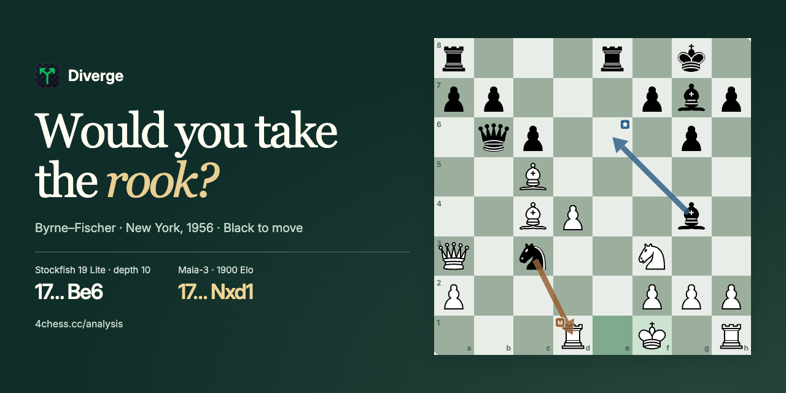

# 把 Maia-3 搬进浏览器：从 PyTorch 权重到棋盘上的两条箭头

1956 年，Donald Byrne 执白对 Robert Fischer。走到 17. Kf1，黑马站在 c3，面前是 d1 上的白车。如果你第一眼想吃车，你和 Maia 在这个局面的预测相当合拍。Diverge 的一次实测中，Maia-3 5M 在 1900 分设定下把 33.1% 的概率给了 17…Nxd1。相同局面下，Stockfish 19 Lite 搜到深度 10，第一选择却是 17…Be6。菲舍尔在棋盘上走的也是这一步。

想在网页上展示这两条箭头，首先要保住它们各自的含义。Stockfish 比较搜索中的变化。Maia 由 CSSLab 开发，预测给定棋力条件下人会如何走棋。33.1% 是模型分给该着的概率。要比较双方，输入要指向同一个局面，界面还得把搜索评分、走法概率和实战着法分别标清。[Maia-3 上游项目](https://github.com/CSSLab/maia3) · [工作台的候选展示](../analysis/position-analysis.js)

## 第一道工序是把权重交给浏览器

训练端的 checkpoint 存着具名张量，浏览器端需要通过名字找到每个张量，还要知道它的形状、存储类型和字节位置。导出器把这些信息写进 JSON 头部，前面放文件标识和头部长度，再按四字节对齐写入权重。浏览器读取时能直接定位一层的权重。5M 版本的导出文件有 29,326,424 字节，已经超过本项目 Pages 静态资产的单文件上限，扩展也不适合让每次安装都为可选模型付出下载成本。[导出器](../scripts/export_weights.py) · [5M 权重版本与校验值](../THIRD_PARTY_NOTICES.md)

Diverge 把下载推迟到真正需要预测时。用户选择模型后，加载器先查 IndexedDB；命中就读回字节，未命中再从模型 CDN 拉取。读取时检查文件头、所选模型规格和张量边界。较大的缓存在 IndexedDB 中分块保存，再按顺序拼回。缓存节省的是网络传输，重新打开后依然有装载和计算成本。这个区别直接影响界面能向用户承诺什么。[模型加载](../engine/model-loader.js) · [分块缓存](../engine/model-cache.js)

## 同一个棋盘，输入也可能不同

FEN 能描述轮到谁走、棋子位置及部分规则状态，却无法还原前几步是怎么走到这里的。PGN 则可以回放。Diverge 会从实战走法重建最近的局面历史；只有 FEN 时，沿用上游无历史输入方式，重复当前局面填充八个时间位置。因此，复现上面的 33.1% 要从同一盘示例棋局进入，还要选同一模型和等级分。单独复制一张棋图，只能复现棋子布局。

推理内核把历史与棋力输入编码到各格，对每个注意力头计算方格对之间的几何偏置，再加到对应的注意力分数上。值得对照检查的是最终输出：同样的权重、历史、行棋方和棋力输入，JavaScript 与 PyTorch 参考计算是否选出同一首选？如果前三项发生交换，概率差多少？仓库提供了对照工具，可以分别检查候选排序和概率误差。[JavaScript 前向计算](../engine/maia-inbrowser.js) · [PyTorch 对照与历史消融工具](../scripts/verify_official_baseline.py)

## 箭头必须属于此刻的棋盘

把推理移进 Worker 后，用户在等待期间仍然能点下一回合。这带来一个很具体的问题：第 17 回合的搜索还没返回，用户已经翻到第 18 回合，旧结果不能画到新棋盘上。工作台给当前分析保存局面上下文和代次，落笔前重新核对；候选只从当前合法着法中选。两个引擎可以分别返回，先到的结果先显示。当前局面、后台整盘复盘、可选的棋力趋势采样也有不同优先级。[工作台调度与渲染](../analysis/position-analysis.js)

放到扩展里，来源也属于上下文。已完赛棋局可以复盘，同一标签页开了新局就必须停止分析。悬浮面板将引擎放在自己的 iframe 和 Worker 中，握手使用一次性令牌；守卫单独决定当前是否允许计算和展示。来源变化时，旧分析和覆盖层都要失效。这样才能让“随手研究这盘棋”与公平竞技规则在同一个产品里成立。[公平竞技守卫](../content/fair-play-guard.js) · [沙箱握手测试](../scripts/test_sandbox_handshake.mjs)

回到伯恩的 17. Kf1：点一下 17…Nxd1，看看吃车后的变化，再回到主线，试试菲舍尔的 17…Be6。对我来说，这就是实现这套浏览器推理最值得的地方：读者可以在自己的棋盘上追问模型的选择，而且马上能动手验证。[打开示例所在的工作台](https://4chess.cc/analysis/?lang=zh&sf=lite&maia=5m&elo=1900) · [项目源码](https://github.com/keluoke/4chess)
